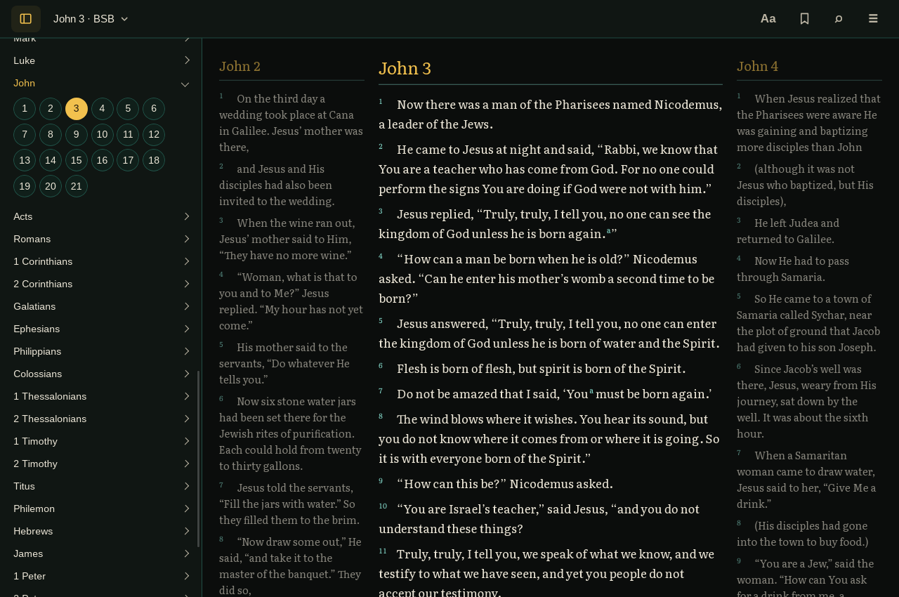
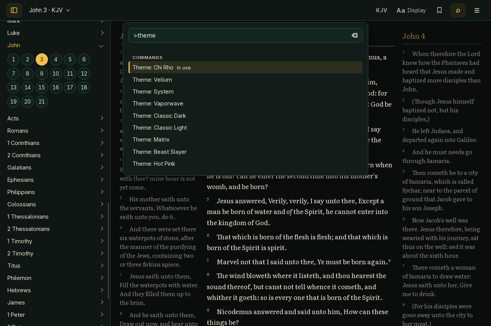
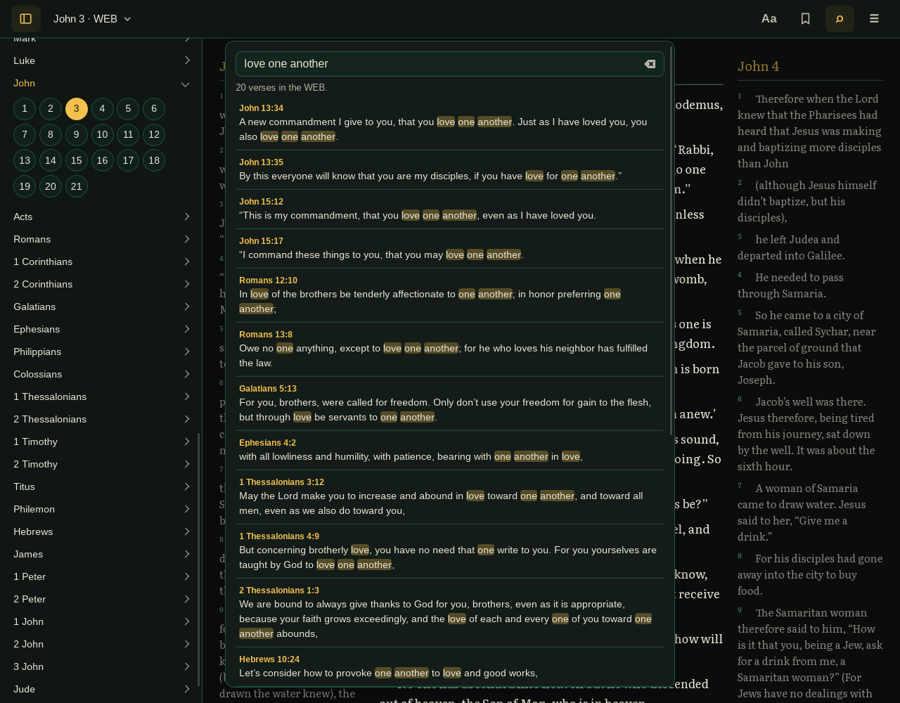
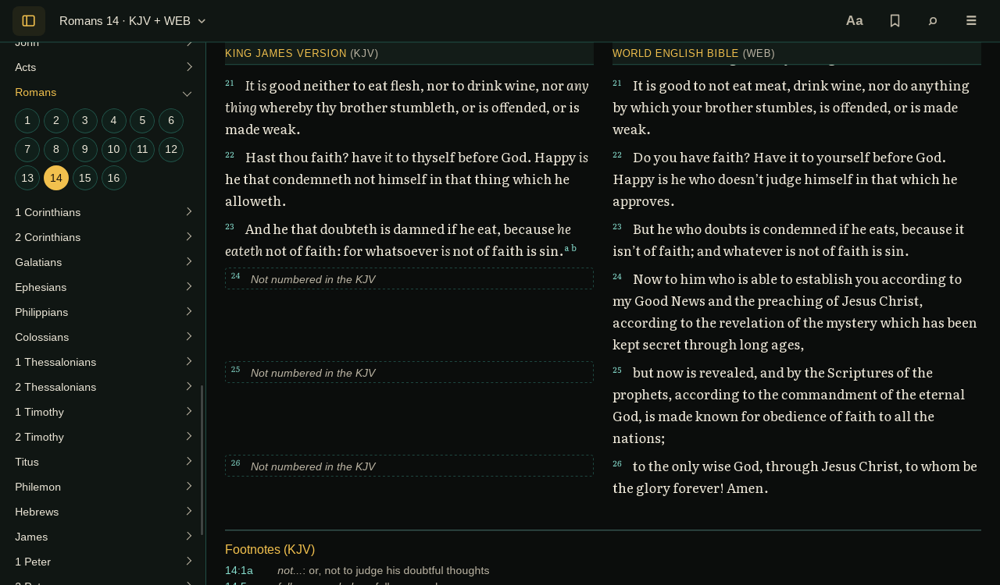

# Gospel Getter

[](https://github.com/tossbaws/gospel-getter/actions/workflows/ci.yml)
[](https://github.com/tossbaws/gospel-getter/actions/workflows/dist.yml)
[](LICENSE)

An offline Bible reader for Linux and Windows. Read the KJV, BSB or WEB a
chapter at a time with the chapters before and after shown alongside,
search the whole Bible, compare any two translations verse by verse, and
copy, bookmark or write notes on passages. No account and no network
needed.


## Features

- **Three complete translations, fully offline.** The King James Version
  (KJV), the Berean Standard Bible (BSB) and the World English Bible (WEB)
  are built into the app, so reading needs no downloads, API keys or
  network access. The translation button in the bar shows the one you're
  reading (**KJV**); it, or `T`, lists them a line each, with each one's
  date and licence. The KJV is the default, and the arrow keys move
  through the list. **About Gospel Getter** credits where each text
  comes from (see [Translations](#translations)).

  

  
- **Read in context.** The chapter you're reading sits in the middle with
  the previous and next chapters faded on either side, scrolling with it.
  ← and → turn chapters across the whole Bible, and each chapter ends with
  buttons for the previous and next chapter.
- **Go to any chapter.** The reference button at the left of the bar
  (`John 3 · KJV`) always says where you are. It, or `G`, opens the book
  and chapter picker: **Random chapter**, then the Old and New Testament
  books, each opening onto its chapters. On wide windows the picker is a
  sidebar you can hide, and on narrow ones a popover. A chapter you choose
  there opens at its top.
- **Search, go to a reference, or run a command.** One box (`/` or Ctrl+K)
  jumps to references such as `John 3:16`, `jn 3:16-18`, `1 Cor 13` or
  `Psalm 23`, and searches the text for anything else. Results show every
  verse in the current translation containing all your words, in Bible
  order, with the words highlighted. Type a book's name, like `Psalms` or
  `1 John`, to go straight to its first chapter, with the verses that
  mention it listed below. The same box runs commands: as you type, it
  lists **Go to**, **Commands** and **Verses**, in that order, and each
  command shows its key, if it has one. Start with `>` to list commands
  only.

  
- **Select verses.** Click a verse, or Shift-click another to select a
  range, and a card opens under them (or above, near the bottom of the
  window) with **Copy**, **Copy as…**, **★ Bookmark**, **+ Add note** and
  the highlight colors, then the verses' footnotes, your notes on them
  and their cross-references. It floats over the text, so the text
  doesn't move. Hold Shift and the card fades and lets clicks through, so
  you can Shift-click a verse it covers.
- **Copy verses with their reference.** Select them, then **Copy** or
  Ctrl+C. You get the verse text (in the KJV, without its margin notes),
  followed by e.g. `— John 3:16–18 (WEB)`. **Copy as…** in the card (or
  Ctrl+Shift+C) offers four formats: text with its reference, with verse
  numbers, a Markdown quote, or plain text. **Copy chapter…**, at the end
  of each chapter, copies the whole chapter in any of them. The status
  line says what was copied.
- **Bookmarks.** Save a verse or range with **★ Bookmark**. Bookmarked
  verses get a ★, and the Bookmarks list in the Library (the bookmark
  button at the top, or Ctrl+B) reopens any of them in whichever
  translation you're reading.
- **Highlights.** Select a verse or range and pick yellow, green, blue or
  pink to highlight it, like a highlighter pen; **Remove highlight** clears
  it. Each theme has its own shades, highlights show in both columns of
  compare mode, and they aren't printed.
- **My highlights list.** The Highlights list in the Library shows every
  highlighted passage in Bible order, with its color, reference and a
  preview in the current translation. Neighboring verses highlighted in
  the same color are one entry (`John 3:16–18`). Filter by color, click a
  passage to open it, or remove its highlight with ×.
- **Notes.** Select a verse or range and choose **+ Add note** (or press
  N) to write about it, in a panel that shows the verses. A passage can
  have several notes, and they show in every translation. A small ✎ marks
  verses with notes, selecting verses shows every note on them, and the
  Notes tab in the Library lists them all in Bible order. Deleting a note
  offers **Undo**. **Export notes…** (in the Library's Notes tab) saves
  them as a Markdown file, with each note's verses quoted in the
  translation you're reading. Pick which books to include, a chapter range
  when you pick one book, and when the notes were written (All time, Last
  7 days, Last 30 days, This year or Custom dates); a live count shows
  how many notes match. In the KJV, translator-supplied words appear in
  italics, as in printed KJVs, and the margin notes are left out.

  
- **Compare any two translations.** Press `C` (or **Compare** under the
  translation button) to see the translation you're reading beside
  another, one row per verse number. **Compare (C) with**, under the same
  button, chooses the other one, and it's remembered; until you choose,
  it's the KJV (or, beside the KJV, the WEB). Where only one translation
  numbers a verse, the other column says so instead of shifting anything.
- **Cross-references.** Select a verse to see related passages in its
  card. Click one to read it right there in the card, a whole range at
  once, in the translation you're reading; click it again to close it, and
  **Go to** opens it. Only one shows at a time. The Cross references list
  at the end of each chapter links straight to each passage, selected.
- **Footnotes (KJV and BSB).** In the KJV, translator-supplied words are
  in italics, as in printed KJVs, and the margin notes are moved out of
  the text into lettered footnotes. The BSB's translators' footnotes are
  lettered where the BSB places them, with alternative readings in
  italics. Select a verse (or click its letter) to see its footnotes in
  its card, and each chapter ends with a Footnotes list of all of them.
  That list and the chapter's Cross references are collapsed until you
  open them, and stay open once you have. Copy and search use the verse
  text without the notes.

  
- **Comfortable reading.** Scripture is set in Literata, bundled with the
  app. Nine themes: Chi Rho (the default), Vellum, System (which follows
  your computer's light or dark setting, as Vellum or Chi Rho), Vaporwave,
  Classic Dark, Classic Light, Matrix, Beast Slayer and Hot Pink. Four text
  sizes (also Ctrl+= and Ctrl+-, and Ctrl+0 for Medium), three line
  spacings, three widths for the text (Narrow, Normal and Wide), a
  layout, and a distraction-free reading mode, all under **Aa**. Printing
  is always black on white.
- **Verses or Flowing.** **Layout** under **Aa** sets the verses one to a
  line (**Verses**, the default) or runs each chapter on as prose with
  small raised verse numbers (**Flowing**), in the chapter you're reading,
  the faded chapters beside it, reading mode and print. Selecting, notes,
  highlights, bookmarks and footnotes work the same in both. Compare always
  shows a verse to a row.

  
- **Everything in reach, out of the way.** A slim bar at the top holds
  the reference button (and, on wide windows, the button that hides or
  shows the sidebar), the translation button (the translations and
  Compare), **Aa** (text and display), the **Library**
  (bookmarks, highlights and notes), search and the **☰** menu (export,
  import, the welcome, the keyboard shortcuts and **About Gospel
  Getter**). Only one panel or popover opens at a time, and Esc closes it.
- **Back and forward through passages.** Alt+← and Alt+→ go back and
  forward through the passages you jumped to (from the picker, search,
  cross-references or the Library), each where you left it. Turning
  chapters isn't a jump, and the list lasts until the app closes.
- **Keys for verses and books.** `j` and `k` select the next or previous
  verse, Shift+j and Shift+k extend the selection, and `[` and `]` go to
  the previous or next book. `?` lists every shortcut (see
  [Keyboard](#keyboard)).
- **Picks up where you left off.** Your chapter, translation, bookmarks,
  highlights, notes and display settings are remembered between sessions.
- **Back up or move your data.** In the ☰ menu, **Export data…** saves your
  bookmarks, highlights, notes, reading position and display settings
  (Width, Layout and compare's translation included) to a
  JSON file, and **Import data…** shows what a file contains before adding
  it (or, if you choose, replacing your bookmarks, highlights and notes).
  Only that personal data is exported, not Bible text or the app's
  database. Files exported by 2.8.0 or newer (data format 3, which adds
  notes) can't be imported by 2.7.0 or older, which say the file is from a
  newer version; files from older versions still import into 2.8.0 and
  newer. Restore a backup made in 2.12 in 2.12 or later: 2.11 and older
  refuse a whole file whose theme they don't know. From 2.12 on, a display
  setting the app doesn't know is skipped, with a notice naming it, and
  the rest of the file imports: 2.12 skips a 2.13 backup's Width that way,
  2.12 and 2.13 skip a 2.14 backup's Layout, and 2.12 to 2.14 skip a 2.15
  backup's compare translation.
  **Export data…** is the backup, and its file imports again; **Export
  notes…** makes a readable copy of your notes, which isn't imported.
- **A short welcome.** On a new install, one card opens over the
  chapter. **Pick a look** tries Chi Rho or Vellum on the spot (the other
  themes are under **Aa**), and **Where to start** suggests Mark, John,
  Psalms or Genesis 1, each a click away. **Skip**, × or Esc closes it
  where you are, and **Show welcome** in the ☰ menu opens it again.
  Upgrading doesn't show it.
- **Updates from inside the app, always asked first.** When it starts,
  Gospel Getter checks GitHub Releases for a newer version and, if there
  is one, shows a banner with the release notes, **Update and restart**
  and **Later**. **Check now** in **About Gospel Getter** shows an update
  it finds right there, with its release notes, **Update now** and
  **Close**. Nothing is downloaded or installed until you choose to
  update. See [Updates](#updates) for which installs
  update themselves and how to turn the check off.
- **A native desktop app.** Built with Tauri: no browser, no background
  server, nothing listening on a port. The window's title says where you
  are (`John 3 · KJV — Gospel Getter`), and the window opens at the size
  and place you left it, on a screen that's still there. It can be as
  small as 640×480.

## A quick tour

All ten screenshots in this README, including the one at the top, use
Chi Rho, the default theme, in a window wide enough for the picker's
sidebar. The other eight themes are under **Aa**.

**Search the text, or jump straight to a reference.** Matching words are
highlighted, and clicking a result opens and selects that verse. Type a
book's name, like `Psalms` or `1 John`, to go straight to its first
chapter, with the verses that mention it listed below.



**Compare two translations verse by verse.** Reading the KJV, compared with
the WEB: in Romans 14 the WEB numbers three verses the KJV doesn't, and
the KJV column says so rather than shifting anything.



**Select a range and copy it with its reference.** The citation in the
card shows exactly what will be copied.


**Bookmark passages and come back to them.** Bookmarked verses are starred
in the text, and the Library (Ctrl+B) lists each one with a preview.


## Keyboard

`?`, or **Keyboard shortcuts** in the ☰ menu, lists every key in the app.
The main ones:

| Key | Does |
|---|---|
| ← / → | Previous / next chapter, across books |
| `[` / `]` | Previous / next book, at its first chapter |
| Alt+← / Alt+→ | Back / forward through the passages you jumped to |
| `G` | Open the book and chapter picker. The arrow keys, Home and End move through it; Enter opens a book or chapter |
| `/` or Ctrl+K | Open the search box, which also runs commands; `>` typed first lists commands only. ↓ / ↑ move through what it lists, and Enter goes there or runs it |
| `j` / `k` | Select the next / previous verse |
| Shift+j / Shift+k | Extend the selection down / up a verse |
| Ctrl+C | Copy the selected verses with their reference. If you've highlighted text yourself, that's copied instead, as usual |
| Ctrl+Shift+C | Copy as…: the selected verses with verse numbers, as a Markdown quote, or as plain text |
| `T` | Open or close the translations and Compare (the translation button) |
| `C` | Compare translations on/off |
| Ctrl+= / Ctrl+- | Larger / smaller text, through the four sizes |
| Ctrl+0 | Text size back to Medium |
| Ctrl+B | Open or close the Library (bookmarks, highlights and notes) |
| `N` | Write a note on the selected verses |
| Shift-click | Extend the selection to a range within the chapter. Holding Shift lets the click through the selection card to a verse it covers |
| Esc | Close search or the open panel or popover, then clear the selection, then leave reading mode |
| `?` | All the keyboard shortcuts |

## Installing

**Download** an installer from the
[latest release](https://github.com/tossbaws/gospel-getter/releases/latest)
(older versions are on the
[Releases page](https://github.com/tossbaws/gospel-getter/releases)). Each
release lists a `SHA256SUMS` file to check them with. From v2.4.0 on, the
files have the same names in every release, so these links always get the
newest one:

- **Linux:** the
  [AppImage](https://github.com/tossbaws/gospel-getter/releases/latest/download/Gospel-Getter_amd64.AppImage)
  (most distros, nothing to install) or the
  [`.deb`](https://github.com/tossbaws/gospel-getter/releases/latest/download/Gospel-Getter_amd64.deb)
  (Debian/Ubuntu).
- **Windows:** the NSIS
  [`setup.exe`](https://github.com/tossbaws/gospel-getter/releases/latest/download/Gospel-Getter_x64-setup.exe)
  (recommended) or the
  [MSI](https://github.com/tossbaws/gospel-getter/releases/latest/download/Gospel-Getter_x64_en-US.msi). **The Windows
  installers aren't code-signed**, so SmartScreen will probably warn about
  an "unknown publisher". Choose "More info → Run anyway".

**Build and install it yourself (Linux).** `packaging/install.sh` builds a
release AppImage and adds a launcher and icon to your desktop.
`packaging/uninstall.sh` removes them. Rerun `install.sh` to update after
changing the code. You'll need Rust and the Tauri CLI
(`cargo install tauri-cli --version "^2.0.0" --locked`).

**Run from source.** `cd src-tauri && cargo tauri dev`.

**Arch Linux.** `packaging/PKGBUILD` is a draft. It hasn't been tested with
`makepkg` and is **not published to the AUR**; the file lists what's left
to do.

Every push to `main` also builds untagged installers as
[workflow artifacts](https://github.com/tossbaws/gospel-getter/actions/workflows/dist.yml).
These expire after a while, so use a release unless you want a specific
`main` build.

## Updates

**Which installs update themselves.** The Windows `setup.exe` and MSI, the
AppImage and the `.deb` from the
[releases page](https://github.com/tossbaws/gospel-getter/releases) install
an update themselves when you choose **Update and restart**. The download
is checked against the release's signature before anything is installed.
Copies built with `packaging/install.sh`, the AUR recipe or from source
can't update themselves: they show the same notice with a **Download
page** button instead, which opens the releases page in your browser.

**The check, and how to turn it off.** The check runs once each time the
app starts. To stop it, turn off **Check for updates when Gospel Getter
starts** in **About Gospel Getter**, from the ☰ menu; **Check now** there
still checks when you ask. About also shows which version you have. It's a setting for this computer and isn't exported. If the
check fails, for example because you're offline, the app says nothing and
works as usual; **Check now** gives up after 20 seconds and says GitHub
couldn't be reached. **Later** hides the notice until the next start. When
**Check now** finds an update, About shows it in place, with its release
notes, **Update now** (with the download's progress) and **Close**, and
the banner doesn't open as well.

**It always asks first.** An update is never downloaded or installed
without you choosing **Update and restart** or **Update now**.

**Privacy.** Checking downloads a small file from GitHub that names the
latest version, so GitHub sees your IP address, as with any download.
Nothing about your reading or your data is sent.

**Coming from 2.6.0 through 2.18.0?** Each updates itself to 2.18.1: it
offers the update when it starts (or from **Check now**, in **About
Gospel Getter** from the ☰ menu in 2.7.0 and later, or in the Updates
section of Settings in 2.6.0), if it's one of the installs above that
update themselves.

**Coming from 2.5.0 or older?** Those versions can't update themselves.
Install 2.18.1 by hand once, from the
[latest release](https://github.com/tossbaws/gospel-getter/releases/latest),
over your current version; updates after that can come from inside the app.
Upgrading keeps your data.

**What changed in each version** is in [CHANGELOG.md](CHANGELOG.md).

## Your data

- Everything (translations, cross-references, reading position, bookmarks,
  highlights, notes and the search index) lives in one SQLite database in the per-app data
  folder. On Linux that's
  `~/.local/share/com.tossbaws.gospel-getter/gospel_getter.db`; on Windows
  it's under `%APPDATA%\com.tossbaws.gospel-getter\`. SQLite may keep
  `-wal` and `-shm` files beside it; they belong with the database.
- **Upgrades keep your data.** A new version adds any new tables and builds
  the search index once, in the background, without changing scripture
  text, your reading position, bookmarks, highlights or notes. 2.10.0
  rebuilds the index once, by itself, so KJV search leaves out the margin
  notes. 2.16.2 switches the database to write-ahead logging when it first
  opens it. Moving back to an older
  version after upgrading hasn't been tested.
- Theme, text size, line spacing, width, layout, compare (and which
  translation it compares with) and reading mode are
  display settings stored in the app's web storage, not the database, as
  are whether the sidebar is shown and whether the chapter's Footnotes and
  Cross references are open (which aren't exported).
- The window's size and place are kept in `window-state.json`, beside the
  database, and aren't exported either.
- Coming from the old browser-based Gospel Getter (the local server on
  `localhost:3002`)? The first launch copies its database from
  `~/.local/share/gospel-getter/data/gospel_getter.db` and leaves the
  original untouched.

## Translations

Three translations are bundled, all public domain, which is what allows
them to ship offline:

| Translation | Date | Licence |
|---|---|---|
| King James Version (KJV), the default | 1611/1769 | public domain |
| Berean Standard Bible (BSB) | 2023 | public domain (CC0) |
| World English Bible (WEB) | | public domain |

The translation button in the bar (or `T`) chooses one; existing readers
keep the one they had. The KJV's margin notes and the BSB's translators'
footnotes are shown as lettered footnotes. **About Gospel Getter** credits each text's source,
and the cross-references' (see [Data provenance](#data-provenance-and-textual-integrity)).
Copyrighted translations such as the NIV and ESV aren't bundled; including
one would need a licence that permits an offline copy.

**Adding a translation** with a licence that allows an offline copy:

1. Add a JSON file to `src-tauri/data/` shaped like `kjv.json`: 66 books in
   canonical order, each `{"name", "testament", "chapters": [[verse, ...], ...]}`.
   A verse the translation doesn't number is `null`. Footnotes kept apart
   from the text go in each book's `footnotes`, as in `bsb.json`.
2. Add an entry to `TRANSLATIONS` in `src-tauri/src/db/seed.rs`.

Existing installs seed only translations they don't already have. To
correct the text of one that's already seeded, clear its rows (its
footnotes, verses and its row in `translations`), or the whole database,
so it seeds again.

## How it's put together

- **Two parts:** `src-tauri/` is the Rust backend (Tauri 2, `sqlx`/SQLite),
  and `ui/index.html` is the whole frontend in plain HTML, CSS and
  JavaScript, with no framework or build step. The frontend calls typed
  Tauri commands, not HTTP.
- **Data model:** book structure is shared between translations, but each
  translation keeps its own verse text and numbering. They number a few
  verses differently, which is expected; the BSB leaves 16 verses
  unnumbered in mid-chapter.
- **Logic:** `domain/bible.rs` works out the previous and next chapter, and
  `domain/query.rs` decides whether search input is a reference or words.
- **Search:** uses an SQLite FTS5 index derived from `verses`. It's never
  written back. It indexes each verse's text as the reader shows it
  (without the KJV's margin notes or the BSB's footnotes), and results
  show that text.
- **Database:** every connection uses SQLite's write-ahead logging, so
  reads and a write don't wait for each other, and the first launch's
  search index build, in the background, doesn't hold up the page. Every
  write goes through one connection, so the app's own writes take turns,
  first come, first served, instead of racing for the write lock; reading
  uses its own connections, which can't write. A transaction that writes
  takes the write lock as it begins (`BEGIN IMMEDIATE`), waiting up to 5
  seconds for it if something outside the app holds it. If the index build
  fails anyway, it's tried again after 1, 2 and 4 seconds before search
  says it's unavailable.
- **Copying:** one formatter in the backend makes the text for Copy, Copy
  as…, Copy chapter and the notes export's quotes. The page fetches it
  ahead and writes it with the webview's own clipboard API, with no plugin
  or extra permission.
- **Links:** the page never opens a web page itself. Release notes and the
  cross-references' credits open in your browser through the backend,
  which opens only addresses on its own fixed list.
- **Content Security Policy:** the webview loads only the app's own
  scripts, styles, fonts and images, and nothing in the page can reach
  the network; only the app's backend can.

## Tests

```bash
# From the repository root; each line runs on its own.
(cd src-tauri && cargo test)                   # backend: database, upgrades, search, references
(cd tests/frontend && npm ci && npm test)      # frontend behavior
```

The frontend tests load the real `ui/index.html` into jsdom and answer its
calls with the app's real command code and a throwaway database, through a
test-only bridge (`src-tauri/examples/frontend_bridge.rs`). CI runs both,
plus `cargo fmt` and Clippy.

## Data provenance and textual integrity

No verse text is altered, cleaned up or "corrected"; every translation is
stored exactly as its source provides it.

- **KJV** comes from the dataset thiagobodruk/bible, which is
  MIT-licensed; the KJV text itself is public domain. That source marks translator-supplied words and marginal notes inline as
  `{...}`, in about 56% of verses. These are kept verbatim, including a
  few places where the source's own markup is broken (Hebrews 10:34 has an
  unmatched `}`). The only changes are structural: removing the file's
  byte-order mark and reshaping the JSON. The stored text keeps the
  markup; the app only changes how it's shown. The reader, Copy, search
  and **Export notes…** present it as print does: supplied words in
  italics (plain in Copy and search, italic in Copy as…'s Markdown quote),
  and margin notes as lettered footnotes in the reader, left out of Copy,
  search and the export. The four verses with broken markup are shown as
  stored, braces and all. Copy as…'s formats change no words: they differ
  only in the verse numbers, the reference and the punctuation around
  them, and leave out the KJV's margin notes and the BSB's footnotes.
- **WEB** comes from TehShrike/world-english-bible, which has no licence
  file of its own; the WEB text it carries is public domain, via
  ebible.org. Verses the source splits into several entries, as in the
  Psalms' poetry, are joined back together in the source's own order, with
  nothing added, removed or reworded.
- **BSB** comes from Berean's own downloads
  ([berean.bible](https://berean.bible/downloads.htm)). It's public domain
  (CC0) since April 30, 2023, and Berean asks that only its verbatim text
  carry its name. Two of their files are kept in
  [`sources/bsb/`](sources/bsb/README.md), exactly as downloaded:
  - `bsb.txt`, sha256 `2ac3af1d…ca96`, gives the verse text byte for byte.
    Reading it only drops its byte-order mark and splits it at its CRLF
    line endings.
  - `bsb_usfm.zip`, sha256 `f0c56438…5f87`, gives the 4,854 footnotes,
    each kept as its own USFM characters. Each is placed where the USFM
    puts it, found by lining up the USFM's wording with the text's.

  The USFM's wording differs from the text's in 1,375 verses (spaced
  dashes, stray marks, spacing slips). The text's wording is used, and
  the differences are listed in
  [`sources/bsb/artifacts.tsv`](sources/bsb/artifacts.tsv), never shown.
  The 16 verses the BSB doesn't number (Matthew 17:21, 18:11, 23:14;
  Mark 7:16, 9:44, 9:46, 11:26, 15:28; Luke 17:36, 23:17; John 5:4;
  Acts 8:37, 15:34, 24:7, 28:29; Romans 16:24) are left out where they
  fall, and the footnote on the verse before each gives its wording. The
  Psalm titles are in verse 1, as Berean has them, and section headings
  aren't shown. A test derives the bundled BSB from these two files again
  and fails on any difference.

Cross-references are from [OpenBible.info](https://www.openbible.info/labs/cross-references/)
under [CC BY 4.0](https://creativecommons.org/licenses/by/4.0/).

## Support

Gospel Getter is free and always will be. If it helps you, you can leave
a tip on [Ko-fi](https://ko-fi.com/crcllc) or on
[the website](https://tossbaws.github.io/gospel-getter/#support). It's
entirely optional and changes nothing in the app.

## License

[MIT](LICENSE).
